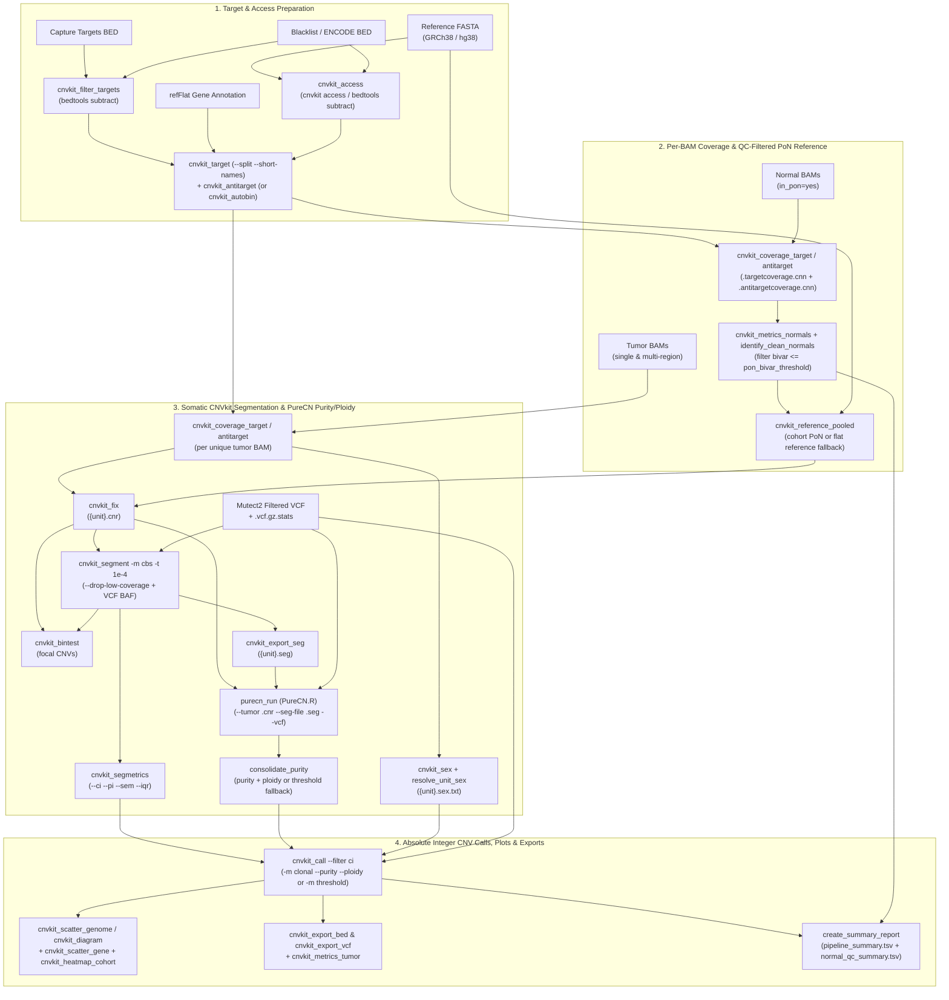

# sm-cnv-calling

Snakemake 8+ somatic copy-number variation (CNV) calling, allele-specific segmentation, and tumor purity/ploidy estimation pipeline combining **CNVkit** and **PureCN** for exome, hybrid-capture, targeted-panel, and whole-genome sequencing on SLURM HPC clusters.



Supports **BIH HPC**, **Charite HPC** (auto-detected by `scripts/run_snakemake.sh`), and local execution.

Part of the [scholl-lab](https://github.com/scholl-lab) bioinformatics suite — designed to run downstream of [sm-alignment](https://github.com/scholl-lab/sm-alignment) and [sm-calling](https://github.com/scholl-lab/sm-calling).

---

## Key Features

- **Shared `samples.tsv` with `sm-calling`**: Directly consumes the same `samples.tsv` used by `sm-calling` (supporting 97-BAM+ cohorts, multi-region `;`-delimited tumor BAMs expanded to `{sample}__{bam_basename}` units, shared normals, `tumor_normal`, `tumor_only`, and PoN-only `germline` rows).
- **Accessible Genome & Blacklist Subtraction**: Automatically computes `cnvkit.py access` when `ref.access_bed` is omitted, and subtracts `ref.blacklist_bed` from both target and access intervals via `bedtools subtract`.
- **Target Bin Splitting & Gene Annotation**: Always runs `cnvkit.py target --split --short-names` (with optional `--annotate refFlat.txt` and `cnvkit.autobin` mode) to prevent unsplit overlapping capture baits and `UNNAMED` bins.
- **Modular Per-BAM Coverage & Allele-Aware CBS**: Deduplicates BAM coverage across multi-region samples, runs BAF-aware CBS segmentation (`-m cbs -t 1e-4 --drop-low-coverage -v {vcf} -i {tumor_id} -n {normal_id}`), computes bootstrap confidence intervals (`cnvkit.py segmetrics --ci --pi --sem --iqr`), and calls focal bin-level CNVs (`cnvkit.py bintest`).
- **QC-Filtered Panel of Normals (PoN)**: Evaluates normal sample noise (`bivar <= pon_bivar_threshold`), passes both `.targetcoverage.cnn` and `.antitargetcoverage.cnn` to `cnvkit.py reference`, and automatically falls back to a flat reference when a cohort has 0 clean normals (or uses a pre-built `cnvkit.reference_cnn`).
- **End-to-End PureCN Integration**: Supports both CNVkit-integrated mode (`purecn.mode: "cnvkit"`, feeding PoN-normalized `.cnr` and `.seg` into `PureCN.R`) and native PureCN NormalDB mode (`purecn.mode: "native"` via `IntervalFile.R --offtarget`, `Coverage.R`, and `NormalDB.R --coveragefiles`) for `tumor_normal` and `tumor_only` samples.
- **Propagated Purity, Ploidy & Sex**: Consolidates PureCN purity and ploidy estimates into `cnvkit.py call -m clonal --filter ci --purity P --ploidy PL` (falling back safely to `-m threshold` when purity is unestimated — never fabricating purity), and propagates chromosomal sex (`-y` / `-x`) across reference, calling, diagrams, and BED/VCF exports.

---

## Quick Start (SLURM: `sm-alignment` -> `sm-calling` -> `sm-cnv-calling`)

### 1. Environment Setup

```bash
conda create -n snakemake -c conda-forge -c bioconda 'snakemake>=8.0'
conda activate snakemake
pip install snakemake-executor-plugin-slurm
```

Per-rule tool environments (`workflow/envs/cnvkit.yaml` and `workflow/envs/purecn.yaml`) are managed automatically by Snakemake with pinned Bioconda versions (`cnvkit=0.9.14`, `bedtools=2.31.1`, `samtools=1.21`, `bcftools=1.21`, `bioconductor-purecn=2.16.1`).

### 2. Generate or Reuse `config/samples.tsv` and `config/config.yaml`

You can reuse `config/samples.tsv` directly from `sm-calling`, or generate a new configuration from an `sm-alignment` BAM folder:

```bash
python scripts/generate_config.py \
    --bam-folder results/exomes/bqsr \
    --vcf-folder results/exomes/variant_calls \
    --targets-bed resources/targets/capture_targets.bed \
    --output-dir results/exomes/cnv_calls \
    --config-template --force
```

### 3. Dry-Run and Submit on SLURM

```bash
# Validate schemas and preview the DAG
bash scripts/run_snakemake.sh config/config.yaml --dry-run

# Submit the Snakemake coordinator job to SLURM (auto-detects BIH or Charite HPC)
sbatch scripts/run_snakemake.sh config/config.yaml
```

For local execution without SLURM:

```bash
snakemake -s workflow/Snakefile \
    --configfile config/config.yaml \
    --workflow-profile profiles/default \
    --profile profiles/local
```

---

## Sample Sheet Format (`config/samples.tsv`)

Compatible with `sm-calling` (`workflow/schemas/samples.schema.yaml`):

| Column | Required | Description |
| :--- | :--- | :--- |
| `sample` | **Yes** | Unique patient / biological sample identifier (e.g., `PAT01`). |
| `tumor_bam` | **Yes** | Tumor/primary BAM basename(s) or path(s). Separate multiple tumor regions with `;` (e.g., `T1_R1;T1_R2`), which expand into `{sample}__{bam_basename}` CNV units. For `germline` rows, put the normal BAM basename here. |
| `normal_bam` | No | Matched normal BAM basename or path (use `.` for `tumor_only` or `germline` rows). |
| `analysis_type` | **Yes** | `tumor_normal`, `tumor_only`, or `germline` (legacy aliases `TvsN` and `To` are also accepted). |
| `in_pon` | No | Include normal BAM in the Panel of Normals (`yes`/`no` or `true`/`false`; defaults to included for `tumor_normal` normals). |
| `sex` | No | Sample chromosomal sex (`female`/`male` or `F`/`M`). If omitted, inferred via `cnvkit.py sex`. |
| `vcf` | No | Explicit somatic VCF path (overrides `paths.vcf_folder`). |
| `vcf_stats` | No | Explicit Mutect2 `.vcf.gz.stats` path (overrides `paths.vcf_folder`). |
| `tumor_sample_id_vcf` | No | Tumor sample name(s) in the VCF header (defaults to the unit's tumor BAM basename). |
| `normal_sample_id_vcf` | No | Normal sample name in the VCF header (defaults to the unit's normal BAM basename). |
| `purity` | No | Optional manual tumor purity override `(0, 1]` used when PureCN is disabled or fails. |
| `ploidy` | No | Optional manual tumor ploidy override `> 0` (defaults to `2.0` when `purity` is provided). |

---

## Configuration Reference (`config/config.yaml`)

Validated against `workflow/schemas/config.schema.yaml`:

| Key | Type | Default | Description |
| :--- | :--- | :--- | :--- |
| `ref.genome` | `str` | *required* | Path to reference genome FASTA file (GRCh38 default). |
| `ref.build` | `str` | `"GRCh38"` | Reference assembly (`GRCh38`, `GRCh37`). |
| `ref.targets_bed` | `str` | *required* | Capture target regions BED path. |
| `ref.baits_bed` | `str` | `""` | Optional capture baits BED (defaults to `targets_bed` for PureCN). |
| `ref.access_bed` | `str` | `""` | Precomputed accessible regions BED. If empty, auto-generated via `cnvkit.py access`. |
| `ref.blacklist_bed` | `str` | `""` | Blacklist BED subtracted from target and access regions via `bedtools subtract`. |
| `ref.ref_flat` | `str` | `""` | UCSC `refFlat.txt` for gene annotation in `cnvkit.py target --annotate`. |
| `ref.mappability_bw` | `str` | `""` | Optional BigWig mappability track for PureCN `IntervalFile.R`. |
| `ref.reptiming_bw` | `str` | `""` | Optional BigWig replication timing track for PureCN `IntervalFile.R`. |
| `paths.samples` | `str` | `"config/samples.tsv"` | Path to sample sheet TSV. |
| `paths.bam_folder` | `str` | `"results/exomes/bqsr"` | Directory containing analysis-ready BAM/BAI files. |
| `paths.vcf_folder` | `str` | `"results/exomes/variant_calls"` | Root `sm-calling` output directory (auto-resolves `mutect2/filtered/{sample}.filtered.vcf.gz` and `mutect2/merged/{sample}.vcf.gz.stats`). |
| `paths.output_folder` | `str` | `"results/exomes/cnv_calls"` | Output root directory. |
| `paths.log_subdir` | `str` | `"logs"` | Subdirectory under `output_folder` for rule logs and benchmarks. |
| `bam.file_extension` | `str` | `".merged.dedup.bqsr.bam"` | Filename suffix appended to BAM basenames. |
| `cnvkit.reference_cnn` | `str` | `""` | Optional pre-built CNVkit reference `.cnn` (skips PoN rules when set). |
| `cnvkit.autobin` | `bool` | `false` | Estimate target/antitarget bin sizes dynamically from BAMs via `cnvkit.py autobin`. |
| `cnvkit.target_avg_size` | `int` | `200` | Target bin size (`--avg-size`) for `cnvkit.py target`. |
| `cnvkit.antitarget_avg_size` | `int` | `150000` | Antitarget bin size (`--avg-size`) for `cnvkit.py antitarget`. |
| `cnvkit.antitarget_min_size` | `int` | `500` | Minimum antitarget bin size (`--min-size`). |
| `cnvkit.access_min_gap_size` | `int` | `5000` | Minimum gap size (`-s`) for `cnvkit.py access`. |
| `cnvkit.pon_bivar_threshold` | `float` | `0.3` | Maximum `bivar` metric for a normal sample to be included in the PoN. |
| `cnvkit.male_reference` | `bool` | `false` | Pass `-y` (`--male-reference`) to CNVkit reference, calling, diagrams, and exports. |
| `cnvkit.segment_method` | `str` | `"cbs"` | Segmentation algorithm (`cbs`, `flasso`, `haar`, `none`, `hmm`, `hmm-tumor`, `hmm-germline`). |
| `cnvkit.segment_threshold` | `float` | `1.0e-4` | Segmentation threshold (`-t`). |
| `cnvkit.drop_low_coverage` | `bool` | `true` | Pass `--drop-low-coverage` during segmentation and calling. |
| `cnvkit.call_method` | `str` | `"clonal"` | Calling mode (`clonal`, `threshold`, `none`); auto-falls back to `threshold` if purity is unestimated. |
| `cnvkit.call_filter` | `str` | `"ci"` | Segment filter (`ci`, `cn`, `sem`, `ampdel`, `none`). |
| `cnvkit.min_variant_depth` | `int` | `20` | Minimum VCF read depth (`-m`) for BAF calculation. |
| `cnvkit.genes_of_interest` | `list[str]` | `["TP53", "MYC", "EGFR", "ERBB2"]` | Genes for locus zoom scatter plots (when `ref.ref_flat` is set). |
| `purecn.enabled` | `bool` | `true` | Enable PureCN purity/ploidy estimation for units with VCFs. |
| `purecn.mode` | `str` | `"cnvkit"` | `"cnvkit"` (use PoN-normalized `.cnr` + `.seg`) or `"native"` (`IntervalFile.R` + `Coverage.R` + `NormalDB.R`). |
| `purecn.genome` | `str` | `"hg38"` | PureCN genome identifier (`hg38`, `hg19`). |
| `purecn.assay` | `str` | `"exome"` | Assay identifier for PureCN mapping bias files. |
| `purecn.fun_segmentation` | `str` | `"none"` | PureCN segmentation function (`none`, `PSCBS`, `CBS`, `Hclust`). |
| `purecn.normal_panel_vcf` | `str` | `""` | Optional normal panel VCF for `NormalDB.R --normal-panel`. |
| `purecn.normaldb` | `str` | `""` | Optional pre-built `normalDB.rds` for `native` mode. |
| `purecn.mapping_bias` | `str` | `""` | Optional pre-built `mapping_bias.rds`. |
| `purecn.snp_blacklist` | `str` | `""` | Optional BED file of blacklisted SNPs passed to `PureCN.R --snpblacklist`. |
| `purecn.seed` | `int` | `123` | Random seed for `PureCN.R`. |
| `purecn.postoptimize` | `bool` | `true` | Pass `--postoptimize` to `PureCN.R`. |
| `params.cnvkit.*` / `params.purecn.*` | `dict` | `""` | Passthrough CLI flags for individual CNVkit and PureCN steps. |

---

## Output Structure

```text
results/exomes/cnv_calls/
├── cnvkit/
│   ├── reference/          # access.bed, targets.clean.bed, targets.bed, antitargets.bed, pooled_reference.cnn
│   ├── coverage/           # {bam_basename}.targetcoverage.cnn, .antitargetcoverage.cnn, .sex.tsv
│   ├── pon_qc/             # all_normals.metrics.txt, clean_normals.list
│   ├── runs/               # {unit}.cnr, {unit}.cns, {unit}.segmetrics.cns
│   ├── calls/              # {unit}.call.cns, {unit}.bintest.cns, {unit}.sex.txt
│   ├── exports/            # {unit}.seg, {unit}.cnv.bed, {unit}.cnv.vcf.gz(.tbi)
│   └── plots/              # scatter_genome/{unit}.genome.pdf, scatter_gene/{unit}/{gene}.pdf, diagram/{unit}.diagram.pdf, heatmap_cohort.pdf
├── purecn/
│   ├── reference/          # intervals.txt, normalDB.rds, mapping_bias.rds
│   ├── coverage/           # {bam_basename}_coverage_loess.txt.gz (native mode)
│   ├── runs/{unit}/        # {unit}.csv, {unit}.rds, {unit}.status
│   └── purity_ploidy/      # {unit}.purity_ploidy.tsv
├── qc/
│   ├── tumor_metrics/      # {unit}.metrics.tsv
│   ├── pipeline_summary.tsv
│   └── normal_qc_summary.tsv
└── logs/
```

---

## Development & Testing

```bash
make lint      # ruff check, ruff format --check, mypy, snakefmt --check, shellcheck
make test      # full pytest suite (schema, helper/tool unit tests, and Snakemake dry-runs)
```
